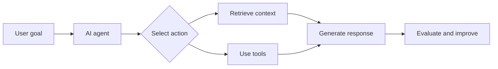

<div align="center">

<h1>👨‍💻 Hi, I'm Wadi Zaatour 👋</h1>

### AI Software Engineering Specialist · Lead Engineer · Product Builder

🧠 AI × ML × Product Engineering · Turning complex ideas into useful experiences

I design and build practical software solutions that connect **AI, modern web development, and thoughtful user experiences**.

<a href="https://github.com/wadizaatour"></a>
<a href="https://www.linkedin.com/in/wadi-zaatour/"></a>
<a href="https://cm-agent.netlify.app/"></a>

</div>

<br />

## 👨‍💻 About me

- 🇳🇱 Based in Utrecht, the Netherlands
- 🤖 Focused on AI-powered applications and developer tools
- 🧠 Exploring machine learning, generative AI, and intelligent automation
- 🧩 Experienced in building clean, responsive frontend experiences
- 🚀 Interested in turning ideas into useful, scalable products
- 🤝 Open to collaborating on meaningful software and open-source projects
- ✍️ I share technical ideas and experiments with the developer community

## 🛠️ Technologies I work with

<div align="center">


</div>

## 🤖 AI & machine learning

I enjoy exploring the space where software engineering meets intelligent systems:

| Area | What I like building and learning |
| --- | --- |
| 🧠 Generative AI | LLM-powered assistants, prompt design, structured outputs, and AI product experiences |
| 🔎 RAG systems | Retrieval-augmented generation, embeddings, vector search, and grounded answers |
| 🧩 Agentic workflows | Agents that plan tasks, use tools, call APIs, and keep humans in the loop |
| 📊 Machine learning | Feature engineering, classification, churn prediction, model evaluation, and explainability |
| 🛡️ Responsible AI | Reliable outputs, source grounding, privacy-aware design, and continuous evaluation |



## 🕹️ Developer power-up

<div align="center">


<br />

`Collect knowledge → Build AI → Level up`

</div>

### 🧪 AI lab: a tiny agent loop

```python
goal = "turn a useful idea into a working product"
context = retrieve_relevant_knowledge(goal)
plan = ai_agent.plan(goal, context)
result = ai_agent.use_tools(plan)
answer = evaluate_and_refine(result)
```

> Every project is a new level: collect knowledge, solve the challenge, and ship the power-up.

## 🚀 Featured projects

| Project | Description | Stack |
| --- | --- | --- | 
| [ResumeBuilder](https://github.com/wadizaatour/ResumeBuilder) | A web application for creating and presenting professional resumes. | JavaScript |
| [TaskPilot](https://github.com/wadizaatour/TaskPilot) | A Vue-based productivity project for organising work and tasks. | Vue |
| [wadiAi](https://github.com/wadizaatour/wadiAi) | An AI-oriented project exploring practical assistant experiences. | Vue |
| [PorfolioApp](https://github.com/wadizaatour/PorfolioApp) | A personal portfolio website for showcasing work and skills. | JavaScript |

## 🌱 What I'm exploring

```text
AI products              ███████████████████░░  90%
Frontend engineering     ██████████████████░░░  85%
Product-focused tooling  █████████████████░░░░  80%
Developer experience     ████████████████░░░░░  75%
Open-source collaboration███████████████░░░░░░  70%
```

## 📊 GitHub activity

<div align="center">

<a href="https://github.com/wadizaatour?tab=repositories"></a>
<a href="https://github.com/wadizaatour?tab=stars"></a>
<a href="https://github.com/wadizaatour?tab=overview"></a>

</div>

## 💬 Let's connect

If you are building an AI product, a useful web application, or an idea that deserves to become real, feel free to reach out or open a discussion.

<div align="center">

### Build something useful. Keep learning. Share what works. 🚀

</div>
